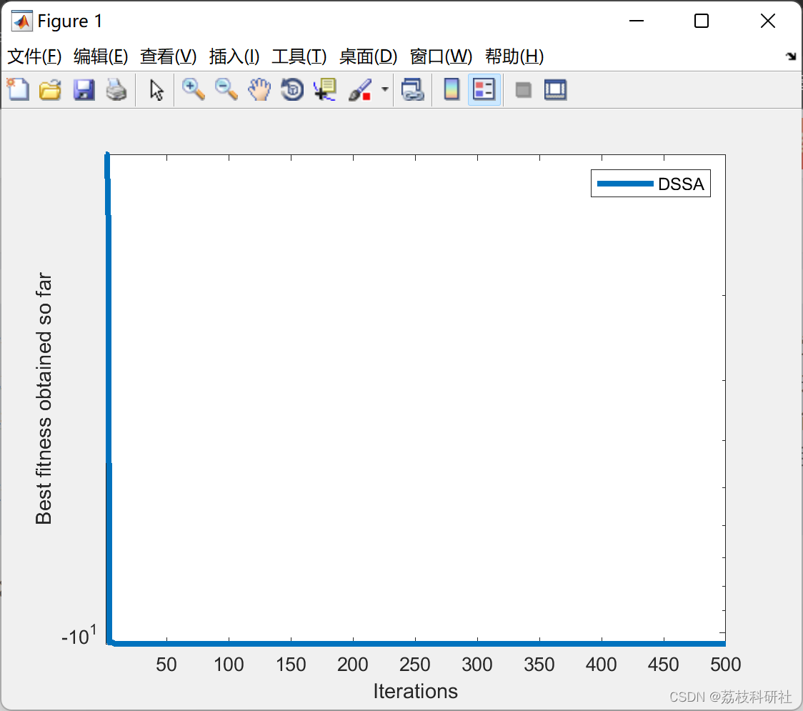

# Differential Squirrel Search Optimization Algorithm (DSSA) (Matlab Code Implementation)

References:
- Editor
- Download link: Differential Squirrel Search Algorithm | SpringerLink
This paper combines the search method of the squirrel search algorithm with the differential evolution optimization process, proposing a new hybrid differential squirrel search algorithm (DSSE) to solve global optimization problems. The main goal is to incorporate the crossover mechanism into the differential evolution algorithm and enhance its exploration capability, and modify the update rule of the squirrels during foraging to improve its exploitation capability. To evaluate its performance, the proposed algorithm is benchmarked against a set of test functions defined in CEC2005. The results show that the proposed algorithm outperforms well-known optimization algorithms including the squirrel search algorithm.📚2 Run results
Part of the code:
%%
function [Destination_fitness,bestPositions,Convergence_curve]=DSSA(NP,Max_iter,lb,ub,npar,fobj)
% Constant initialization and memory initialization
Gc=1.9; % Gliding constant
Cr=0.5; % crossover rate
dg=0.8; %Random gliding distance
Pdp=0.1; %predator presence probability
Convergence_curve=zeros(1,Max_iter);  
Fitness=ones(1,NP)*inf;  
% Initialization of the Squirrel
Pos=initialization(NP,npar,ub,lb);  
% Fitness evalaution of each Squirrel  
for i=1:NP  
Fitness(i)=fobj(Pos(i,:));  
end  
% Segregating the Squirrel into hickory, acorn and normal tree  
[Sorted_fitness,Sort_index]=sort(Fitness);  
Pos_hickory=Pos(Sort_index(1),:); % best solution (hickory tree)  
Pos_acorn=Pos(Sort_index(2:4),:); % acorn tree  
Pos_normal=Pos(Sort_index(5:end),:); % normal tree  
L=size(Pos_normal,1);  
L1=randperm(L);  
% Squirrels in normal tree splitted into two sets randomly  
Pnormal_1=Pos_normal(L1(1:end-10),:);  
Pnormal_2=Pos_normal(L1(end-10+1:end),:);  
G=Sorted_fitness(1); % best fitness  
Convergence_curve(1)=Sorted_fitness(1);  
for itr=2:Max_iter  
Pos_avg=mean(Pos,1); % average of all squirrels position in the current population  
%Temporary new location of squirrels in acorn and normal trees  
Pacorn_tree=[];  
Pnormal_1_tree=[];  
Pnormal_2_tree=[];  
%New locations of squirrels present in the acorn trees  
for i=1:3  
if rand>Pdp  
Pacorn_tree(i,:)=Pos_acorn(i,:)+dg*Gc*(Pos_hickory-Pos_acorn(i,:)-Pos_avg); %Eq(1)  
else  
Xrand=initialization(1,npar,ub,lb);  
Pacorn_tree(i,:)=Xrand-rand(1,npar).*abs(Xrand-2*rand*Pos_acorn(i,:));  
end  
% Crossover  
Xacorn_tree=[];  
Jrand=randi([1,npar],1);  
for k=1:npar  
if ((k==Jrand)||(rand<=Cr)) %Eq(2)  
Xacorn_tree(1,k)=Pacorn_tree(i,k);  
else  
Xacorn_tree(1,k)=Pos_acorn(i,k);  
end  
end  
if fobj(Xacorn_tree)<fobj(Pacorn_tree(i,:))  
Pacorn_tree(i,:)=Xacorn_tree;  
end  
end  
%New locations of some of the squirrels present in the normal trees  
for i=1:size(Pnormal_1,1)  
if rand>Pdp  
k=randi(3,1);  
Pnormal_1_tree(i,:)=Pnormal_1(i,:)+dg*Gc*(Pos_acorn(k,:)-Pnormal_1(i,:)); %Eq(3)  
else  
Xrand=initialization(1,npar,ub,lb);  
Pnormal_1_tree(i,:)=Xrand-rand(1,npar).*abs(Xrand-2*rand*Pnormal_1(i,:));  
end  
% Crossover  
Yat=[];  
Jrand=randi([1,npar],1);  
for k=1:npar  
if ((k==Jrand)||(rand<=Cr))  %Eq(5)  
Yat(1,k)=Pnormal_1_tree(i,k);  
else  
Yat(1,k)=Pnormal_1(i,k);  
end  
end  
if fobj(Yat)<fobj(Pnormal_1_tree(i,:))  
Pnormal_1_tree(i,:)=Yat;  
end  
end  
%New locations of remaining squirrels present in the normal trees  
for i=1:size(Pnormal_2,1)  
if rand>Pdp  
Pnormal_2_tree(i,:)=Pnormal_2(i,:)+dg*Gc*(Pos_hickory-Pnormal_2(i,:)); %Eq(4)  
else  
Xrand=initialization(1,npar,ub,lb);  
Pnormal_2_tree(i,:)=Xrand-rand*abs(Xrand-2*rand*Pnormal_2(i,:));  
end  
% Crossover  
Zat=[];  
Jrand=randi([1,npar],1);  
for k=1:npar  
if ((k==Jrand)||(rand<=Cr)) %Eq(5)  
Zat(1,k)=Pnormal_2_tree(i,k);  
else  
Zat(1,k)=Pnormal_2(i,k);  
end  
end  
if fobj(Zat)<fobj(Pnormal_2_tree(i,:))  
Pnormal_2_tree(i,:)=Zat;  
end  
end  
Pnt=[Pnormal_1_tree; Pnormal_2_tree];  
Ph1=Pos_hickory+dg*Gc*(Pos_hickory-mean(Pos_acorn,1)); %Eq(6)  
if fobj(Ph1)<fobj(Pos_hickory)  
Pos_hickory=Ph1;  
end  
Pnew=[Pos_hickory; Pacorn_tree; Pnt];  
FTnew=[];  
% Updating the population  
for i=1:NP  
FTnew(i)=fobj(Pnew(i,:));  
if FTnew(i)<Fitness(i)  
Fitness(i)=FTnew(i);  
Pos(i,:)=Pnew(i);  
else  
Pos(i,:)=Pos(i,:);  
Fitness(i)=Fitness(i);  
end  
end  
[Sorted_fitness,Sort_index]=sort(Fitness);  
% Update Best squirrel positions in hickory tree  
if Sorted_fitness(1)<G(itr-1)  
Pos_hickory=sort(Pos(Sort_index(1),:),2);  
G(itr)=Sorted_fitness(1);  
else  
G(itr)=G(itr-1);  
end  
%Updated locations of squirrels in acorn trees  
Pos_acorn=Pos(Sort_index(2:4),:);  
%Updated locations of squirrels in normal trees  
Pos_normal=Pos(Sort_index(5:end),:);  
L=size(Pos_normal,1);  
L1=randperm(L);  
Pnormal_1=Pos_normal(L1(1:end-10),:);  
Pnormal_2=Pos_normal(L1(end-10+1:end),:);  
% Keeping all iteration best fitness value  
Convergence_curve(itr)=G(itr);  
end  
Destination_fitness=Convergence_curve(end);  
bestPositions=Pos_hickory;  
end  
🌈3 Matlab code implementation
🎉4 References
​  

## Images

<!-- PAYMENT_BLOCK -->

## Get this dataset

- Payment link (Stripe): [Buy now](https://buy.stripe.com/3cs8yP7sY87d0vu9AB)
- Payment QR code: 

<!-- /PAYMENT_BLOCK -->
